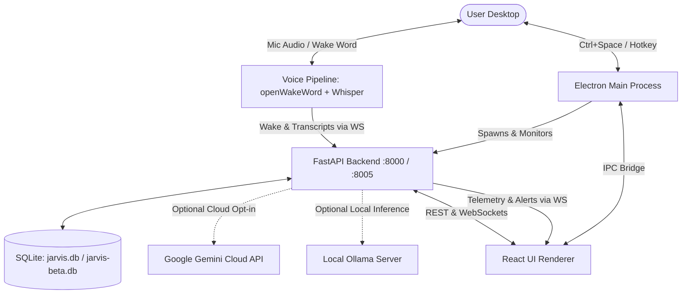

# V.E.G.A. (AgentOS) — Architecture & Design

## 1. System Architecture
V.E.G.A. adopts a local hybrid client-server desktop architecture consisting of:
1. **Electron Shell:** Host container managing the desktop overlay window, system tray, global hotkeys, Windows native notifications, and lifecycle supervision of the backend process.
2. **React Renderer:** High-performance HUD user interface communicating with the backend over local HTTP and real-time WebSockets.
3. **FastAPI Backend:** Local asynchronous Python service handling deterministic action parsing, SQLite persistence, background cron/scheduler, system telemetry, and the offline voice pipeline.



## 2. Frontend
- **Framework:** React 18 with Vite bundling.
- **State Management:**
  - `useChat.js`: Conversational message history, active model state, speech synthesis session with generational utterance guards (`createSpeechSession`).
  - `voiceState.js`: Finite state machine reducer for voice status (`idle` -> `wake` -> `listening` -> `processing` -> `transcript`).
  - `healthPoller.js`: Background health probe tracking service status, aborting stale requests, and managing session verification state.
  - `productivityUpdates.js`: Centralized event pub/sub publishing committed action receipts to automatically refresh mounted ProductivityHub views.
  - `notificationService.js`: Dual-path alert dispatcher routing through Electron IPC native notifications (when hidden) or in-app toasts (when visible) with composite key deduplication.
- **Visual Design:** Vanilla CSS design tokens with Tailwind CSS utility classes, supporting 4 themes (`sci-fi-hud`, `glass`, `terminal`, `neural-cosmos`).

## 3. Backend
- **Framework:** FastAPI with Uvicorn server running asynchronously on `127.0.0.1:8000` (production) or `127.0.0.1:8005` (beta profile).
- **Core Modules:**
  - `command_parser.py`: High-speed deterministic regex parser routing natural language intents (tasks, timers, reminders, notes, apps) to tool handlers before any LLM is consulted.
  - `policy.py`: Risk classification engine (Risk 0..3) verifying permissions, action parameters, and initiation origins.
  - `verifier.py`: Session validation, request authorization, and cryptographic action receipt generation.
  - `scheduler.py`: Background SQLite-backed job queue for timers and reminders with restart recovery and orphan healing.
  - `voice_service.py`: Multi-threaded audio capture, openWakeWord detection, Silero VAD, faster-whisper transcription, and pending-interruption state machine.
  - `telemetry.py`: Hardware statistics collector (psutil, GPUtil, platform).

## 4. Database
- **Engine:** SQLite 3 with WAL (Write-Ahead Logging) mode enabled.
- **ORM:** SQLAlchemy with declarative models (`db.py`).
- **Tables:**
  - `tasks`: To-do items with completion status, priority, category, deadline.
  - `workspaces`: Projects with goal, current blocker, and next action.
  - `session_notes`: Timestamped markdown session scratchpads linked to workspaces.
  - `coursework`: Academic modules, assignments, and tracked study minutes.
  - `scheduled_alerts`: Timers and reminders with recurrence, due time, and delivery status.
  - `action_receipts`: Immutable audit log of all executed mutating actions.
- **Migrations & Integrity:** `migrations.py` applies versioned DDL migrations, validates indices and column existence, performs SQLite online backups, and prevents corruption.

## 5. APIs and WebSockets
- **REST Endpoints:**
  - `GET /health`: Core and service readiness, profile identity, run ID, and deterministic mode status.
  - `POST /api/chat`: Chat interaction handling deterministic fast-path, local Ollama, or cloud Gemini.
  - `POST /api/tasks`, `GET /api/tasks`, `PATCH /api/tasks/{id}`: CRUD for tasks.
  - `POST /api/timers`, `GET /api/timers`, `DELETE /api/timers/{id}`: Timer lifecycle.
  - `POST /api/reminders`, `GET /api/reminders`: Reminder management.
  - `POST /api/workspaces`, `GET /api/workspaces`: Project tracking.
  - `POST /api/voice/enabled`, `GET /api/voice/enabled`: Microphone and wake listener toggle.
  - `POST /api/voice/duck`: Backend TTS audio ducking toggle.
  - `POST /api/voice/interrupt_ack`: Correlated interruption acknowledgement fallback.
- **WebSockets:**
  - `WS /ws/telemetry`: Hardware metrics stream at 1Hz.
  - `WS /ws/voice`: Real-time voice pipeline state, wake triggers, and transcripts.
  - `WS /ws/alerts`: Live notification and alert dispatch to the frontend.

## 6. Authentication & Session Verification
- **Local Loopback Security:** All network listening is restricted to `127.0.0.1`.
- **Session Verification Contract (`apiConfig.js` & `main.py`):**
  - Launcher creates an opaque `run_id` shared by backend and Electron.
  - Beta mode requires matching `profile == "beta"` and exact `run_id`.
  - Mutating HTTP requests (`POST`, `PATCH`, `DELETE`) are gated through `verifiedFetch` and `mutationGuard`.
  - Stale health checks or timeouts immediately revoke verification and block writes.

## 7. AI Components
- **Deterministic Engine (Risk 0 / Tier 1):** Regex parsing (`command_parser.py`) resolving daily actions instantly at ₹0 cost without network dependencies.
- **Local LLM (Tier 2):** Ollama integration (`/api/generate`) for offline contextual reasoning when configured.
- **Cloud LLM (Tier 3):** Google Gemini SDK (`google-generativeai`) with per-request timeouts, explicit user opt-in, and zero key inheritance in beta mode.

## 8. Data Flow
1. **Command Flow:** User input (voice transcript or chat text) -> `command_parser.py` matches intent -> `policy.py` validates risk tier -> tool handler mutates database -> `ActionReceipt` stored -> response returned to UI -> `publishProductivityUpdate()` refreshes mounted Hub components.
2. **Interruption Flow:** User says "Hey Jarvis" while VEGA speaks -> backend `_audio_thread` detects wake -> enters `_interruption_pending` -> emits `wake` with `interrupt: true, interruption_id: ...` -> frontend immediately calls `window.speechSynthesis.cancel()` and sends interrupt ACK -> backend receives ACK, flushes pre-ack audio queue, resets VAD, and arms fresh command recording.

## 9. Folder Structure
```
jarvis-dashboard/
├── backend/
│   ├── command_parser.py     # Deterministic natural language router
│   ├── db.py                 # SQLite database models & engine
│   ├── main.py               # FastAPI entry point, routers, WebSockets
│   ├── migrations.py         # SQLite migrations & schema validation
│   ├── policy.py             # Risk classification & safety policy
│   ├── scheduler.py          # Timer & reminder background loop
│   ├── verifier.py           # Receipts & action authorization
│   ├── voice_service.py      # openWakeWord, Whisper, interruption engine
│   └── tests/                # Pytest unit & regression tests
├── frontend/
│   ├── electron/
│   │   ├── main.js           # Electron host, tray, hotkey, process manager
│   │   └── preload.cjs       # Secure IPC bridge
│   ├── src/
│   │   ├── App.jsx           # Main HUD shell & keyboard shortcuts
│   │   ├── components/       # UI views (AIBrain, ProductivityHub, etc.)
│   │   ├── hooks/            # useChat, useTelemetry, etc.
│   │   └── lib/              # apiConfig, healthPoller, voiceInterruption, etc.
│   └── tests/                # Node.js native unit tests
├── docs/                     # Project documentation, logs, acceptance checklists
├── scripts/
│   ├── launch_beta.js        # Synthetic beta runner
│   ├── launcherHelpers.js    # Port, env, and process tree helpers
│   └── seed_beta.js          # Synthetic data seeder
├── package.json              # Workspace scripts
└── README.md                 # Primary documentation
```

## 10. Deployment & Packaging
- **Development:** `npm run dev` (personal) or `npm run dev:beta` (synthetic test).
- **Desktop Packaging:** PyInstaller packages the FastAPI backend into a standalone Windows executable (`jarvis-backend.exe`), while `electron-builder` packages the Electron shell into a signed NSIS installer. Production databases reside in `%APPDATA%\Jarvis_Dashboard\`, never in `Program Files`.

## 11. Security & Safety Rules
- **No Unrestricted Shell:** VEGA never executes arbitrary shell commands on behalf of LLM proposals.
- **Fail-Closed Policy:** Malformed action payloads, ambiguous parameters, or unverified sessions reject writes without side effects.
- **Clean Profile Isolation:** Beta mode actively scrubs `backend/.env` and inherited cloud API keys from memory on startup.
